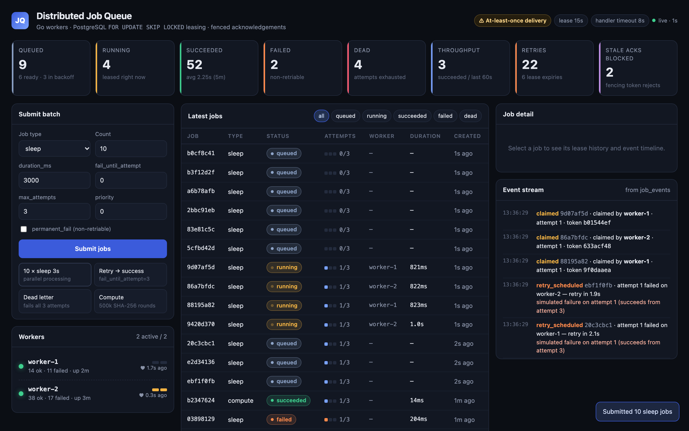
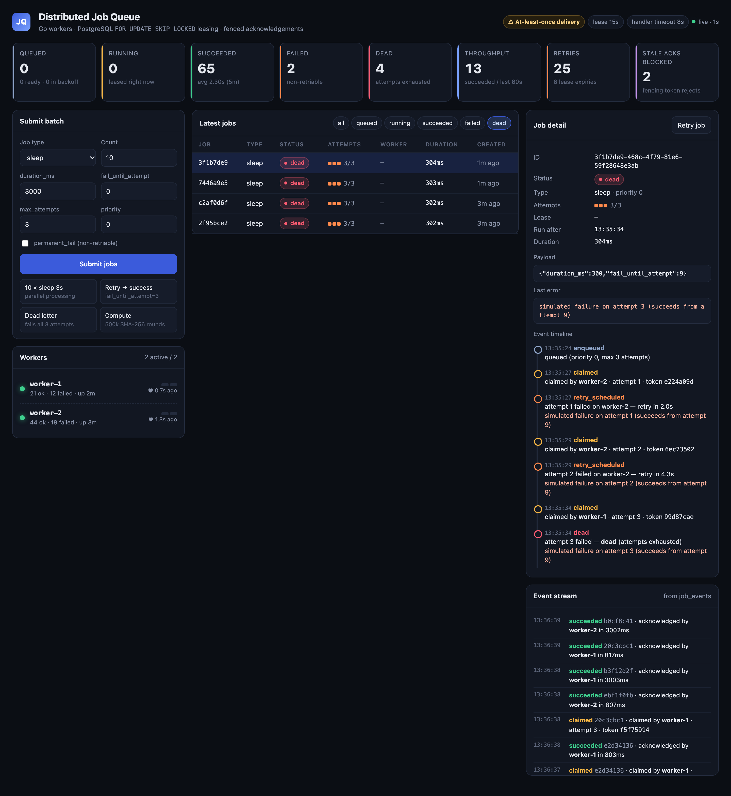

# Distributed Job Queue (Go + PostgreSQL)

An HTTP API for typed background jobs and independently deployed Go workers.
PostgreSQL is the **only** coordination point: no Redis, no broker, no shared memory.
Workers claim jobs with `SELECT … FOR UPDATE SKIP LOCKED` and hold a time-bound
**lease** with a **fencing token**. A worker can be `kill -9`'d mid-job, and the job is
reclaimed and finished by another worker. A stale worker can never overwrite the newer attempt.

> **Delivery guarantee: at-least-once, not exactly-once.** A worker may finish a job's
> side effects and crash before acknowledging. The job then runs again. Handlers must be
> idempotent. The built-in `compute` handler is deterministic, so a re-run produces the same result.

## Screenshots

| Two workers processing a batch in parallel | Dead-letter job with full retry history |
|---|---|
|  |  |

## Architecture

```
                 ┌──────────────────────────┐
  browser ──────▶│  API  (cmd/api)          │  POST /api/jobs, GET /api/jobs, /workers, /metrics
  curl    ──────▶│  + embedded dashboard    │  validates input, never executes jobs
                 └────────────┬─────────────┘
                              │ INSERT job + 'enqueued' event
                              ▼
                 ┌──────────────────────────────────────────────┐
                 │ PostgreSQL                                   │
                 │  jobs        (status, attempts, run_after,   │
                 │               lease_owner, lease_token,      │
                 │               lease_until, result, …)        │
                 │  job_events  (append-only timeline)          │
                 │  workers     (heartbeats)                    │
                 └───▲───────────────▲───────────────▲──────────┘
     claim (SKIP LOCKED) │  fenced ack     │  reaper: expired  │ heartbeat
                         │                 │  leases → queued  │
                 ┌───────┴──────┐   ┌──────┴───────┐   ┌───────┴──────┐
                 │  worker-1    │   │  worker-2    │   │  worker-N    │
                 │  N slots     │   │  N slots     │   │  …           │
                 └──────────────┘   └──────────────┘   └──────────────┘
```

### Job lifecycle

```
            claim (attempts++ , new lease_token)
  queued ─────────────────────────────────────▶ running ──── handler ok + token valid ───▶ succeeded
    ▲  ▲                                          │ │ │
    │  └──── retriable error, attempts < max ─────┘ │ └── permanent error ─────────────▶ failed
    │        (run_after = now + backoff)            │
    │                                               └──── retriable error, attempts = max ─▶ dead
    └──── lease expired (reaper), attempts < max ── (attempts = max ─▶ dead)

  failed / dead ── POST /api/jobs/{id}/retry ──▶ queued   (attempts reset to 0, logged)
```

### Invariants and how they're enforced

| Invariant | Mechanism |
|---|---|
| Two workers never hold the same job at once | Claim is one atomic statement: `UPDATE … FROM (SELECT id … ORDER BY priority DESC, created_at LIMIT 1 FOR UPDATE SKIP LOCKED)` |
| Only the current attempt can acknowledge | Each claim mints `lease_token = gen_random_uuid()`. Complete/Fail use `WHERE status='running' AND lease_token=$token AND lease_until > now()` |
| Clocks don't matter | All lease math uses Postgres `now()`, never worker clocks |
| No transaction held during execution | Claim commits immediately. The handler runs outside any transaction. The ack is a separate conditional update |
| Handlers can't outlive their lease | Startup fails unless `HANDLER_TIMEOUT_SECONDS < LEASE_SECONDS` |
| `max_attempts=3` ⇒ at most 3 claims | `attempts` increments on claim. Failure or lease expiry at `attempts >= max_attempts` → `dead` |
| A running row always has a full lease | DB `CHECK` constraint `lease_matches_status` |

Backoff after attempt *n* is `min(2^(n-1) × 2s, 60s)` ±10% jitter (2s, 4s, 8s, …). Tests inject a deterministic jitter.

## Quick start

```bash
docker compose up -d --build      # postgres + api + worker-1 + worker-2; migrations run automatically
open http://localhost:8080        # dashboard
./scripts/seed.sh                 # optional: a mix of successes, retries, dead letters, failures
./scripts/demo.sh                 # crash demo: SIGKILL worker-1 mid-job, watch worker-2 reclaim
./scripts/fencing-demo.sh         # fencing demo: freeze worker-1 past its lease, unpause, its late acks are rejected
```

### What the demos show (real output)

```
job 3279bfd4:  claimed(worker-1, attempt 1) → [worker-1 SIGKILLed] → lease_expired (reaped by worker-2)
               → claimed(worker-2, attempt 2) → succeeded            # exactly one 'succeeded' event per job

job ee68f6d9:  claimed(worker-1) → [worker-1 paused 21s] → lease_expired → claimed(worker-2, attempt 2)
               → stale_ack_rejected {"op":"complete","worker":"worker-1"} → succeeded(worker-2)
```

Requirements: Docker with Compose. **No local Go toolchain needed.** The image build and
tests both run in containers.

The demo compose uses `LEASE_SECONDS=15` and `HANDLER_TIMEOUT_SECONDS=8`, so lease recovery
is visible in about 15s. Code defaults follow the spec: 60s and 20s.

## Tests

```bash
./scripts/test.sh            # go test ./...         (unit + integration, in Docker)
./scripts/test.sh -race      # go test -race ./...
./scripts/test.sh -v -run Fencing
```

Integration tests use a separate `jobs_test` database, created automatically, on the
compose Postgres, so the running demo's data is untouched. They are skipped when
`TEST_DATABASE_URL` is unset. CI (`.github/workflows/ci.yml`) runs vet, tests, `-race`, and the image build.

| Area | Tests |
|---|---|
| Unit | backoff schedule + jitter clamp, transition eligibility, lease-token fencing rule, payload validation, handler cancellation, panic → permanent error, API status codes/auth/validation, cursor encoding, config validation |
| Integration (real Postgres) | 200 jobs × 12 concurrent claimers → zero duplicates; SKIP LOCKED passes over a locked row without blocking; priority/age claim order; expired-lease recovery → reclaim as attempt 2; **stale token rejected for both complete and fail**, even before the reaper runs; attempts cap → dead; backoff delays reclaim; manual retry semantics; stable keyset pagination; two real worker loops share the work with exactly one ack per job; crashed worker's job reclaimed and the zombie's late ack fenced; graceful shutdown releases in-flight work |

## API

All write endpoints require `X-API-Key: <key>` (or `Authorization: Bearer <key>`) when
`API_KEY` is set. Reads are public. Errors are `{"error": "...", "request_id": "..."}`.

```bash
# Submit
curl -X POST localhost:8080/api/jobs \
  -d '{"type":"sleep","payload":{"duration_ms":500},"max_attempts":3,"priority":0}'
# → 201 {"id":"0b7c…","status":"queued"}

curl -X POST localhost:8080/api/jobs -d '{"type":"compute","payload":{"input":"hello","iterations":100000}}'

# Simulate failures (demo only)
curl -X POST localhost:8080/api/jobs -d '{"type":"sleep","payload":{"duration_ms":300,"fail_until_attempt":3}}'  # 2 retries, then succeeds
curl -X POST localhost:8080/api/jobs -d '{"type":"sleep","payload":{"duration_ms":300,"permanent_fail":true}}'   # → failed

# Read
curl 'localhost:8080/api/jobs?status=running&limit=50'      # {"jobs":[…],"next_cursor":"…"|null}
curl 'localhost:8080/api/jobs?limit=50&cursor=<next_cursor>'
curl localhost:8080/api/jobs/<id>                            # {"job":{…},"events":[…]}
curl localhost:8080/api/workers                              # heartbeat age, state active|stale|stopped
curl localhost:8080/api/metrics                              # counts, queue depth, throughput, expiries, fenced acks
curl localhost:8080/api/events?limit=30                      # global event stream
curl -X POST localhost:8080/api/jobs/<id>/retry              # dead/failed only, else 409
curl localhost:8080/health/live ; curl localhost:8080/health/ready   # ready = DB reachable, else 503
```

| Status | When |
|---|---|
| 400 | unknown type, malformed JSON/payload, unknown fields, `duration_ms` out of range, bad `max_attempts`/`priority`/`status`/`limit`/`cursor`/UUID |
| 401 | `API_KEY` set and missing/wrong on a write |
| 404 | job not found |
| 409 | retry of a job that isn't dead/failed |
| 413 | body > 64 KB (payload cap 16 KB) |
| 503 | database unavailable |

### Job types

| type | payload | notes |
|---|---|---|
| `sleep` | `duration_ms` (1–`MAX_SLEEP_MS`, ≤10000) | honours cancellation |
| `compute` | `input` (≤256 chars), `iterations` (1–2,000,000, default 100k) | iterated SHA-256, deterministic → idempotent |

Both accept `fail_until_attempt` (retriable failure while `attempt < N`) and `permanent_fail`.
There is **no arbitrary code execution and no outbound HTTP**. The spec's webhook handler
was left out on purpose to avoid SSRF on a public demo.

## Configuration

See `.env.example`. Every process is configured only via environment variables:
`DATABASE_URL`, `API_KEY`, `PORT`, `WORKER_ID`, `WORKER_CONCURRENCY`, `POLL_INTERVAL_MS`,
`LEASE_SECONDS`, `HANDLER_TIMEOUT_SECONDS`, `HEARTBEAT_SECONDS`, `REAP_INTERVAL_SECONDS`,
`SHUTDOWN_GRACE_SECONDS`, `WORKER_STALE_SECONDS`, `MAX_SLEEP_MS`.

Logs are structured JSON (`log/slog`) with request IDs (`X-Request-ID` is echoed back).
The connection string is never logged, only host and database name.

## Deploying (hosted)

The image contains both binaries. Run it as two kinds of services against one managed Postgres:

1. Provision Postgres 13+ (Neon, Supabase, RDS, Render, Fly Postgres) and get its `DATABASE_URL` (`sslmode=require`).
2. **API service:** image from this Dockerfile, command `/app/api`, env `DATABASE_URL`, `API_KEY`, `PORT`.
   Health check `GET /health/ready`. Expose it publicly.
3. **Worker service:** same image, command `/app/worker`, env `DATABASE_URL`, plus a unique `WORKER_ID` per instance
   (or leave it unset to use the hostname). Run 2+ instances. No inbound port is needed.
4. Migrations run automatically on startup of either process (guarded by an advisory lock).

On Render/Railway/Fly this is one web service plus one background worker with 2 instances.
Set `API_KEY` for any public deployment, because the dashboard then prompts for it before submitting.

## Design trade-offs and limitations

- **Polling, not push.** Each worker slot polls every `POLL_INTERVAL_MS` when idle. This is simple and robust,
  but it adds up to one poll interval of latency and constant light DB load. Next step: `LISTEN/NOTIFY` to wake
  workers, then a broker if throughput outgrows one Postgres.
- **Throughput ceiling.** This was not benchmarked. A single Postgres with row-level claims comfortably handles portfolio scale
  (hundreds of jobs per second). It is not meant to replace Kafka/SQS at high volume.
- **At-least-once.** Covered above. Fencing prevents a stale *acknowledgement*, but it cannot un-run a side effect.
- **No lease renewal.** Jobs must finish inside `HANDLER_TIMEOUT_SECONDS` (< lease). Long jobs would need heartbeat-based renewal.
- **Lease expiry consumes an attempt.** A job whose worker crashes on its last attempt goes `dead`. This is intended,
  because it protects against poison jobs that crash workers.
- **Manual retry resets `attempts` to 0**, giving a fresh budget. The previous status and attempt count are kept in a `manual_retry` event.
- **Single shared API key.** There is no per-tenant auth, rate limiting, or job retention/cleanup.
- **`job_events` grows unbounded.** Metrics scan the tables, which is fine at demo scale but needs indexes/rollups beyond it.

## Layout

```
cmd/api, cmd/worker        entrypoints
internal/config            env config + validation (timeout < lease)
internal/queue             Postgres repository (all SQL), migrations runner, pure transition rules
internal/worker            claim → execute → fenced ack loop, heartbeat, reaper, graceful shutdown
internal/handlers          sleep + compute handlers, strict payload validation
internal/httpapi           stdlib net/http (Go 1.22 patterns), middleware, auth
internal/observability     slog JSON logger, request IDs
migrations/                SQL (embedded)
web/                       single-file dashboard (embedded, no build step)
tests/integration          Postgres-backed tests
scripts/                   test.sh, demo.sh, seed.sh
```
